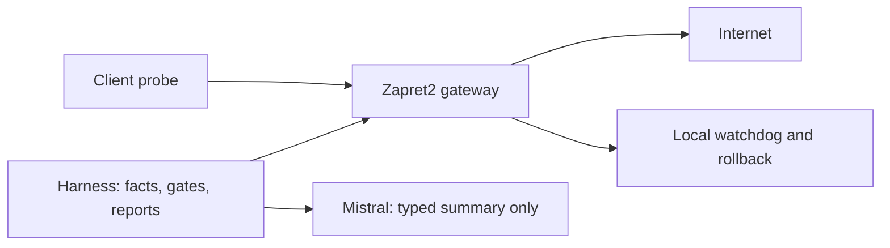

# Zapret2 Harness

Учебный Docker-стенд по [SPEC.md](SPEC.md). LLM предлагает; детерминированный
код решает. Основной провайдер — Mistral API, модель `mistral-small-latest`.
Ключ передаётся только через `MISTRAL_API_KEY`.

Разработка идёт по фазам; состояние и ограничения записаны в [PROGRESS.md](PROGRESS.md).

