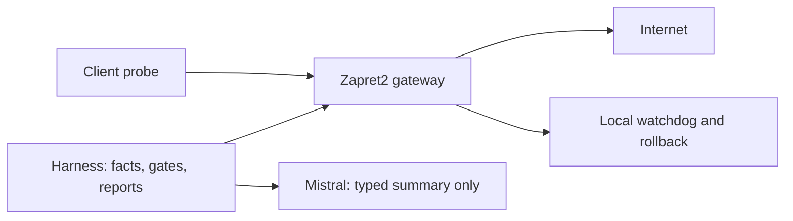

# Zapret2 Harness

Учебный Docker Compose-стенд по [SPEC.md](SPEC.md): blockcheck2 → raw archive →
типизированные факты → clean wins/gates → перепроверка → компактная сводка →
структурированный выбор кандидата → обратимая выкатка. LLM предлагает,
детерминированный код решает.

**Проверено 29.09.2026:** 69 offline-тестов на Windows и Linux, сборка трёх
контейнеров, live-топология, upstream blockcheck, две NFQUEUE-точки, recheck,
watchdog и настоящий rollback, в том числе при остановленном Harness.
[Живые результаты и границы проверки](docs/LIVE-VERIFICATION.md) сохранены отдельно
от `PASS_SIMULATED` приёмки. Допуск по двум реальным датам ещё не измерен.

## Архитектура



Harness и Zapret — разные контейнеры. Client подключён только к `lab_net`,
default route ведёт через Zapret. У lab bridge отключены IPv4-адрес шлюза Docker
и host masquerade; при выключенном Zapret клиент теряет выход. `management`
внутренняя; наружу выходит сеть `uplink`. Управляющие порты не публикуются на host.
API содержит конечный список операций и проверяет token из отдельного volume.
Docker socket не монтируется. `privileged` не используется.

Zapret2 зафиксирован на
[`00f5aaa36de500971faf6db440dd7d8b25672281`](https://github.com/bol-van/zapret2/tree/00f5aaa36de500971faf6db440dd7d8b25672281).
`zapret/instrument.py` добавляет в blockcheck2 запись структурированных событий
в отдельный файл. Перебор и обработка пакетов остаются upstream Zapret2.
Инструментатор проверяет точные anchors и прерывает сборку при несовместимом исходнике.

## Почему LLM не принимает окончательное решение

Ворота вычисляются до обращения к модели. Модель получает только числовой
короткий список уже допущенных кандидатов и вердикты инвариантов. Ответ содержит
индекс или `abstain`. Стратегию код извлекает из локального списка. На узле
применения ворота пересчитываются под блокировкой и проверяется свежая успешная
перепроверка с обеих точек. Модель не имеет инструментов и не читает raw logs.

## Требования и Docker compatibility

- Python 3.12+ для разработки; Linux Docker Engine и Compose 2.33.1+ для стенда.
- Kernel с nftables, NAT, forwarding и NFQUEUE; контейнеру Zapret нужны
  `NET_ADMIN`, `NET_RAW`, `NET_BIND_SERVICE`, `SETUID`, `SETGID`, `KILL`.
  Последняя нужна blockcheck для завершения nfqws2 после перехода на другой UID.
- Docker Desktop должен работать в режиме Linux containers.
- Доступ к GitHub/PyPI/Debian mirrors при сборке.
- На Windows локально работают детерминированные тесты. Firewall/probes выполняются в Linux.

`doctor` проверяет control API, nftables, клиентский маршрут и фактическое
приращение счётчика FORWARD при пробе с клиента. DNS у gateway и client обслуживает
один dnsmasq на gateway; текущий upstream resolver — `1.1.1.1` в entrypoint.
Автоматическая настройка физического роутера и аппаратного flow offload не выполняется.
`internal: true` на lab bridge блокирует транзит к peer-router в проверенной среде.
Вместо него используется
[inhibit_ipv4](https://docs.docker.com/engine/network/drivers/bridge/#skip-bridge-ip-address-configuration)
без host NAT; фактический путь проверяется счётчиком и отключением gateway.

## Быстрый запуск

```sh
cp .env.example .env
# Укажите MISTRAL_API_KEY в локальном .env либо окружении запуска Compose.
docker compose build
docker compose up -d
docker compose exec harness harness doctor
docker compose exec harness harness pipeline
```

PowerShell: вместо первой команды используйте `Copy-Item .env.example .env`.
Секрет не добавляется в Git. Пример `.env.example` содержит только имя переменной.
Один прогон не может дать допуск: нужны как минимум два разных прогона в две
разные даты. Примерные домены замените своими до измерений.

По умолчанию sweep разрешён с 21:00 до 03:00 UTC (00:00–06:00 Europe/Moscow).
Вне окна команда отказывает; по окончании окна процесс перебора останавливается.
Полный sweep требует выключенного боевого обхода. При установленной стратегии
используйте выборочную перепроверку; она не останавливает боевой процесс.

## Конфигурация и классы доменов

`config/domains.yaml` задаёт `classes: {имя: [домены]}`. Класс — единица допуска.
Проверки требуют покрытия всех настроенных доменов класса: это консервативнее
минимума Т-6.2. HTTP/TLS и IPv4/IPv6 не смешиваются при подсчёте ворот.

`config/harness.yaml` содержит пороги адресов, попыток, прогонов/дат, watchdog,
перепроверок, бюджета и UTC-расписания. Измеренные пороги изменяйте только после
нового замера. Проектный live sweep/recheck использует IPv4 + HTTPS TLS 1.2;
слой проб также поддерживает HTTP, TLS 1.3 и IPv6, когда сеть это позволяет.

## Pipeline и CLI

```text
doctor          диагностика без выкатки
run / sweep     blockcheck2 в ограниченном ночном окне, сохранение raw
ingest          инкрементальный импорт; --since ISO_TIME; --rebuild для всего архива
analyze         импорт текущего прогона, gates, invariants, summary
summarize       тот же проверенный путь построения summary
llm             выбор индекса или отказ; --provider mock для работы без API
recheck         выборочная перепроверка, обе точки, разные адреса
deploy          применение выбранного кандидата; --run-id ID завершённой перепроверки
watchdog        один проход локального сторожа (он также работает автоматически)
rollback        восстановить backup на Zapret
reconcile       expected/live сверка; --initialize для явного начального снимка
report          прочитать сохранённый отчёт
acceptance      выполнить тесты и сформировать отчёт П-1…П-12
llm-eval        offline evaluation; --live явно включает запрос к платному API
pipeline        sweep → ingest/analyze → recheck → LLM → отчёт
```

`--run-id UUID` позволяет продолжать сохранённый прогон; `pipeline --run-id UUID`
пропускает новый sweep. `--config PATH` выбирает основной YAML конфиг.
Pipeline автоматически не выкатывает стратегию: `deploy` — отдельная команда,
требующая подтверждённых ворот и завершённой свежей перепроверки.
При ошибке ingestion downstream останавливается и пишет отчёт с `STOPPED`.

## LLM: Mistral

Production provider: **Mistral**, model: **`mistral-small-latest`**.
Запрос идёт только на **`https://api.mistral.ai/v1/chat/completions`**, с
`response_format.type=json_schema`, `strict=true`, `additionalProperties=false`.
Схема дополнительно проверяется локально через strict Pydantic.

Ключ читается **только из `MISTRAL_API_KEY`**. Параметра ключа в YAML, CLI или
конструкторе провайдера нет; другие переменные ключей не используются. Ключ
доступен только harness-контейнеру. Перенаправления HTTP запрещены; внешние
ошибки API не печатаются вместе с телом ответа или Authorization.

Абстракция `Provider` и `MockProvider` находятся в `harness/src/harness/llm.py`.
Для mock задайте `llm.provider: mock` либо `--provider mock`. Недоступный Mistral
не заменяется молча mock-провайдером. Невалидная схема получает ровно один
повтор с исходным ответом и validation error; второй промах завершает запрос
контролируемым отказом. Индекс вне списка отклоняется. Если кандидатов ноль
или один, либо инвариант не пройден, арифметика разрешает вопрос без API.

Сохраняются usage-токены обеих попыток и имя модели, возвращённое API.
Денежная стоимость указана `null / not_returned_by_provider`: Mistral не возвращает
сумму счёта в обычном completion response, и проект не выдумывает тариф.
Лимит summary — 16 KiB, настраивается. Raw и стратегии не входят в selection prompt.

Дополнительные типизированные lanes в `llm_tasks.py`: разметка, черновик точечных
замен, приоритетная причина потери, расширение сетки в рамках словаря корпуса.
Черновики не исполняются. Причина потери вычисляется по порядку
UNMEASURED → MEASUREMENT_INTEGRITY → BASELINE_CHANGED → FAILURES → THIN_WINS → UNKNOWN.

Официальные контракты: [Chat Completions](https://docs.mistral.ai/api),
[Structured Outputs](https://docs.mistral.ai/studio/conversations/structured-output/custom).

## Тестирование и приёмка

```sh
python -m venv .venv
# Активируйте .venv (Windows: .venv\Scripts\Activate.ps1)
python -m pip install -e '.[dev]'
python -m ruff check harness zapret tests
python -m pytest -q
harness acceptance
```

Тесты не требуют Internet или платного API. HTTP-контракт Mistral проверяется
через `httpx.MockTransport`. Отдельная реальная проверка API:

```sh
harness llm-eval --live
```

Она отправляет только синтетическую типизированную сводку. Это проверка API,
не живой замер DPI. Подробнее: [LIVE-VERIFICATION.md](docs/LIVE-VERIFICATION.md).

## Данные

- `data/raw/<run_id>.log`: исходный stdout/stderr blockcheck2.
- `data/raw/<run_id>.events.jsonl`: отдельный журнал доверенных событий.
- `data/raw/<run_id>.json`: metadata; `*.recheck.jsonl`: факты перепроверки.
- `data/facts/facts.sqlite3`: canonical факты; `facts.jsonl`: inspect/export.
- `data/summaries/`: общая сводка и ограниченный `summary.json` для LLM.
- `data/reports/`: JSON, Markdown, acceptance XML/log.
- `data/state/`: expected state, selection, результаты ingestion/recheck.
- Docker volume `zapret_state`: конфигурация, backup, lease и deployment state на узле.

Повторная загрузка идемпотентна по `(run_id, timestamp, sequence)`. Конфликт по
этому ключу отклоняется транзакционно. Незавершённый tail учитывается отдельно;
ошибка внутри завершённой записи прерывает ingestion.

## Выкатка, watchdog, rollback

Меняется только `strategy.conf`, одна строка. До изменения сохраняется backup и
состояние `prepared`. После запуска nfqws2 проверяется процесс. Ошибка запуска
немедленно восстанавливает старую строку. Проверки и реальный запуск используют
массивы аргументов, без shell interpolation.

Baseline снимается для **всех** настроенных доменов и обеих точек, включая другие
классы общей стратегии. Watchdog живёт в Zapret-контейнере, использует OS-lock и
не зависит от Harness/LLM. Одиночная осечка не откатывает; offline client отмечается
UNMEASURED. После окна — `accepted`, либо `closed_inconclusive`, если починка не была
измерена. Перезапуск узла во время незакрытой выкатки восстанавливает backup.

Временная перепроверка исключает только заданные имена из active-профиля через
hostlist-exclude, направляя их во второй nfqws2. Lease хранит абсолютный срок;
локальный сторож/старт узла убирает просроченное исключение. Живая проверка дала
четыре OPEN-факта с двух точек для двух доменов, каждый минимум на двух IP;
после истечения lease candidate остановлен, active сохранил PID.

## Ограничения среды и область реализации

- Live-прогоны — управляемая лабораторная проверка на example-доменах.
  Короткие диагностические окна и fixture допуска не заменяют два настоящих
  ночных прогона, квалификацию стратегии под конкретный DPI и реальные домены.
- Внешнее зеркало не настроено: отчёты явно содержат `external_delivery=NOT_CONFIGURED`.
  Есть интерфейс ReportSink и проверки громкой ошибки доставки; П-10 live не закрыт.
- В этом lab нет tunnel-ветки и аппаратного ускорения. Поддержка физического
  роутера/embedded-runtime заменена Docker-архитектурой из задания.
- Gates сохраняют исторические провалы: новый допуск после изменения среды требует
  явного нового архива/набора измерений, а не молчаливого удаления неудобных фактов.
- Платный Mistral API не вызывался: ключ не предоставлен; проверен HTTP-контракт на mock.

## Продолжение разработки и соответствие SPEC

Начните с SPEC.md, [PROGRESS.md](PROGRESS.md), `git status` и `git log --oneline -15`.
Затем выполните тесты и при необходимости повторите живые проверки. Историю и
накопленные факты не сбрасывайте. Карта каждого Т-* и П-* находится в
[docs/REQUIREMENTS.md](docs/REQUIREMENTS.md).
